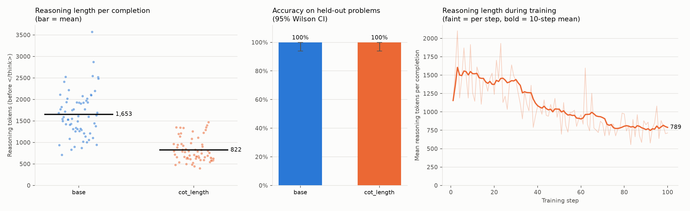

# Eval Awareness: GRPO + LoRA Trial

A minimal end-to-end trial. It loads the OLMo 3.1-32B-Think checkpoint, runs a few GRPO steps with LoRA and a simple task reward, saves the adapter, then reloads it and generates a response. Its only purpose is to validate the training setup; the actual research experiment comes later.

The model weights go into the weights dir, and the weights should not be committed.

## Setup

```bash
conda create -y -p /path/to/envs/eval-awareness python=3.12
conda activate /path/to/envs/eval-awareness
pip install torch==2.14.1 --index-url https://download.pytorch.org/whl/cu126
pip install -r requirements.txt
```

`requirements.txt` pins the versions from the validated runs. On Misha the env is at `/gpfs/radev/project/krishnaswamy_smita/gss34/envs/eval-awareness` (project storage, since home is near its file-count quota); the sbatch scripts use it by default, and `ENV=...` overrides it.

## Dataset format

The dataset is a JSONL file with `prompt` and `answer` fields:

```jsonl
{"prompt": "What is 7 * 6?", "answer": "42"}
{"prompt": "What is the capital of France?", "answer": "Paris"}
```

A completion gets reward 1.0 if the answer after the model's `</think>` block matches, and 0.0 otherwise. Numeric answers (`5`, `11/16`, `\frac{11}{16}`, `0.6875`) are compared by value using the last `\boxed{}` (or the last number); text answers need a whole-word match. See `src/rewards.py`.

## Run

```bash
MODEL_PATH=/cluster/path/to/OLMo-3.1-32B-Think \
DATASET_PATH=/cluster/path/to/trial.jsonl \
bash scripts/train.sh
```

Optional: `OUTPUT_DIR` (default `results/trial`) and `CONFIG` (default `configs/trial.yaml`). To change hyperparameters, edit `configs/trial.yaml` or point `CONFIG` at a copy of it. You don't need to change the source code.

## Outputs

```
results/trial/
├── adapter/        # LoRA adapter
├── config.yaml     # resolved config
├── metadata.json   # seed, paths, versions, GPUs, times, status, verification response
└── metrics.json    # training metrics and per-step logs
```

The run succeeded if `metadata.json` shows `"status": "succeeded"`, `global_step` is at least 1, and `verification_response` is not empty.

## Troubleshooting

- **Out of memory:** lower `max_completion_length` or `num_generations`, or run on more GPUs (the model is sharded with `device_map="auto"`).
- **Batch size error:** `per_device_train_batch_size * gradient_accumulation_steps` must be divisible by `num_generations`.
- **LoRA target-module error:** check the module names with `print(model)` and update `lora.target_modules`.
- **GRPOConfig/GRPOTrainer argument errors:** the TRL API changes between versions, so compare against the docs for the installed version.
- **All rewards are 0:** a Think model may not finish reasoning within `max_completion_length` tokens (it used 1.5k-2.4k tokens on simple probability questions), so the adapter barely changes. The trial config uses 2048.
- **All rewards are 1 (`grad_norm` 0):** if every completion in a group is correct, GRPO has no signal. The trial's easy questions do this; it still validates the pipeline, but the adapter is unchanged.

## Experiment: CoT length penalty

Does GRPO with a reward that only penalizes chain-of-thought length shorten OLMo 3.1-32B-Think's reasoning, and what happens to accuracy?

### Setup

- **Data:** `scripts/make_prob_data.py` generates simple probability problems with exact fraction answers (at-least-k-heads, expected count of a die face, Bayes with a loaded coin, two-dice sums, urn draws). 100 training problems (`data/prob_train.jsonl`) and 33 held-out problems (`data/prob_eval.jsonl`: 30 generated, no overlap with training, plus the 3 hand-written prompts in `prompts/probability.txt`).
- **Reward:** only `-reasoning_tokens / max_completion_length`, where reasoning is everything before `</think>`. Correctness is logged during training but has weight 0. See `configs/prob_cot_length.yaml`.
- **Training:** LoRA (r=16, attention projections) + GRPO, 100 steps, 2 prompts x 4 generations per step, lr 1e-4, beta 0.01, temperature 0.6, max 3072 completion tokens. Seed 42.
- **Eval:** `src/evaluate.py`, 2 samples per held-out problem (66 completions per model), temperature 0.6, up to 8192 new tokens. Base model vs. base + adapter.

### Run

```bash
sbatch scripts/run_length_experiment.sbatch
```

One H200 job runs base eval, training, adapter eval, then `src/analyze.py` (table and figure). It took 4h05m on Misha (2026-10-20): base eval 24 min, training 3.5 h, adapter eval 11 min. Outputs land in `results/eval/` (`summary.md`, `summary.csv`, `cot_length.png`, and per-completion `base.jsonl` / `cot_length.jsonl` with full reasoning) and `results/prob_cot_length/` (adapter and training metrics).

### Results

| Model | Accuracy (95% CI) | Finished thinking | Reasoning tokens, mean ± SE | Median | Range | Response tokens (after `</think>`) | Δ reasoning vs base |
|---|---|---|---|---|---|---|---|
| base | 100% [94%, 100%] | 100% | 1,653 ± 66 | 1,596 | 714-3,569 | 306 | - |
| cot_length | 100% [94%, 100%] | 100% | 822 ± 34 | 749 | 399-1,469 | 220 | **-50%** |

Mean reasoning tokens by problem family:

| Family | base | cot_length | Δ |
|---|---|---|---|
| expected_face | 1,944 | 774 | -60% |
| urn_draw | 1,468 | 599 | -59% |
| at_least_heads | 1,846 | 974 | -47% |
| dice_sum | 1,582 | 867 | -45% |
| handwritten | 1,545 | 920 | -40% |
| bayes_coin | 1,400 | 901 | -36% |



- **Reasoning halved with no accuracy loss.** Accuracy stayed at 100% on the held-out set, and training-time accuracy (logged, not rewarded) was 1.0 at every logged step.
- **No reward hacking via the response.** The penalty only counts tokens before `</think>`, but the response after it also got shorter (306 to 220 tokens), so reasoning was cut rather than moved.
- **Training curve:** reasoning length was flat (~1,400-1,500 tokens) for about 30 steps, fell between steps 30 and 75, and leveled off around 790. KL to the base model rose to 0.056 by step 100.
- **What was cut is mostly redundant re-verification.** Mean occurrences per completion, base to trained: "Alternatively" 2.2 to 0.4, check/verify/confirm 4.5 to 2.3, wait/hmm 7.1 to 3.6. The trained model still verifies its answer once (for example, re-deriving 6/11 with the odds form of Bayes).

### Limitations

- One training run and seed, with no task-only control: the comparison is to the base model.
- The held-out problems come from the same five families as training, so this shows in-distribution shortening, not transfer to other tasks.
- 66 completions per model can't detect an accuracy drop smaller than about 5 percentage points, and these problems are easy for the model (base accuracy is 100%).
