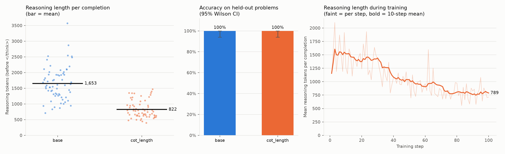

# Eval Awareness: GRPO + LoRA

Research code for studying evaluation awareness in chain-of-thought models: GRPO with LoRA on OLMo 3.1-32B-Think (Hugging Face Transformers / TRL), run on Yale's Misha cluster (H200).

Phase 1 (this state of the repo) provides the shared infrastructure that every experiment uses: one training entry point, a config system, a pluggable reward interface, an LLM judge for evaluation awareness, run/output management, SLURM launch scripts, and tests. Individual experiments are added as a reward module plus a config.

Model weights go in `weights/` and are never committed, and neither are generated datasets, run outputs, or credentials (see `.gitignore`).

## Setup

```bash
conda create -y -p /path/to/envs/eval-awareness python=3.12
conda activate /path/to/envs/eval-awareness
pip install torch==2.14.1 --index-url https://download.pytorch.org/whl/cu126
pip install -r requirements.txt
```

`requirements.txt` pins the versions from the validated runs. On Misha the env is at `/gpfs/radev/project/krishnaswamy_smita/gss34/envs/eval-awareness` (project storage, since home is near its file-count quota); the SLURM scripts use it by default, and `ENV=...` overrides it.

## Run an experiment

From the repo root on a Misha login node:

```bash
# Validate config, dataset and rewards without a GPU or model weights (seconds):
CONFIG=configs/trial.yaml DRY_RUN=1 bash scripts/submit_experiment.sh

# Smoke test: one tiny GRPO step, save the adapter, reload it, generate (loads the 32B model twice):
CONFIG=configs/trial.yaml SMOKE_TEST=1 sbatch --time=01:00:00 scripts/submit_experiment.sh

# Trial run (5 steps with the validated hyperparameters):
CONFIG=configs/trial.yaml SEED=42 sbatch scripts/submit_experiment.sh
```

The script checks that the env, config, checkpoint and dataset exist, and that CUDA is visible in the job, before training. It regenerates `data/prob_*.jsonl` (deterministic) if a config needs them. Useful variables: `MODEL_PATH` (default `weights/Olmo-3.1-32B-Think`), `DATASET_PATH`, `SEED`, `OUTPUT_ROOT`, `ENV`. Anything after the script name goes to `src/train.py`, for example `--set training.max_steps=50`. GPUs, memory and time are sbatch flags, for example `sbatch --gres=gpu:h200:2 --mem=320G --time=12:00:00 scripts/submit_experiment.sh`; the model is sharded over all visible GPUs. Submit from the repo root: the scheduler log goes to `results/slurm-<job>-<id>.out`.

Inside an interactive GPU session you can call the entry point directly:

```bash
python src/train.py --config configs/trial.yaml --seed 7 --set lora.r=8
python src/train.py --config results/trial/<run>/config.yaml     # rerun from a saved resolved config
```

Settings are resolved in this order: CLI flags and `--set key=value` first, then environment variables (`MODEL_PATH`, `DATASET_PATH`, `EVAL_DATASET_PATH`, `OUTPUT_ROOT`, `OUTPUT_DIR`, `EXPERIMENT_NAME`, `SEED`), then the YAML file, then the defaults in `src/config.py`. Relative input paths are resolved against the repo root and stored as absolute paths in the run's `config.yaml`.

## Outputs

Every run gets a new directory, `results/<experiment>/<timestamp>_seed<seed>[_job<slurm id>]/`, and no run ever overwrites another. An explicit `OUTPUT_DIR` must be new or empty.

```
config.yaml              resolved config: enough, with the seed, to reproduce the run
metadata.json            status, phase, seed, model and dataset identifiers (path, sha256), reward specs,
                         package versions, git commit, GPUs, SLURM job, timings, error and traceback
train.log                all stdout/stderr from the run
metrics.jsonl            one line per logging step, written while training (survives crashes)
metrics.json             final metrics: total reward, each reward component, KL, full log history
dropped_examples.jsonl   examples rejected by dataset validation, with line numbers and reasons (if any)
adapter/                 LoRA adapter + tokenizer
```

A run completed successfully if and only if `metadata.json` has `"status": "succeeded"`. That requires training to finish, the adapter to be saved, and the reloaded adapter to generate a non-empty `verification_response`. Otherwise the status is `failed` (with `error`, `traceback` and the `phase` it stopped in) or `interrupted` (SIGTERM from a SLURM time limit or `scancel`).

TRL logs each reward component as `rewards/<metric>/mean` and `/std` (unweighted), the weighted total as `reward`, and the KL to the base model as `kl` (only when `beta > 0`).

## Architecture

```
src/
  train.py          shared entry point: config -> tokenizer -> data -> rewards -> model -> GRPOTrainer(+LoRA)
                    -> train -> save adapter/metrics -> reload adapter + generate -> status
  config.py         defaults, YAML loading, env/CLI overrides, validation (batch divisibility, etc.)
  data.py           JSONL loading + schema validation, chat formatting, prompt-length filter, drop log
  modeling.py       model/tokenizer loading, stop tokens, LoRA config + target validation, generation
  experiment.py     unique run dirs, metadata.json, log capture, incremental metrics
  thinking.py       split "<reasoning></think><response>" completions
  grading.py        answer checking (numeric/fraction/boxed, text)
  rewards/          reward registry; one module per reward strategy
    base.py         Reward interface, @register, RewardContext
    task.py         task correctness (1/0)
    cot_length.py   CoT-length penalty (preliminary experiment)
  judge/            evaluation-awareness LLM judge (rubric, backends, parsing, cache)
  run_judge.py      run the judge on sample completions
  infer.py, evaluate.py, analyze.py   generation, held-out evaluation, tables/figures
```

`train.py` contains no experiment-specific logic. The reward list in the config decides what is optimized.

### Thinking-model handling

OLMo 3.1 Think's chat template ends the generation prompt with `<|im_start|>assistant\n<think>`, so a completion is `<reasoning></think><final answer>`. `</think>` is ordinary text (three BPE tokens), so it survives decoding, and TRL passes rewards the raw text because the tokenizer has no response schema. `thinking.split_completion` separates reasoning from the final answer. A completion without `</think>` is unfinished reasoning with an empty answer, so a truncated chain of thought is never graded as an answer. Generation stops at `<|endoftext|>` (the checkpoint's only eos) and also at `<|im_end|>`; the stop ids are recorded in `metadata.json`.

### Adding a reward

Create `src/rewards/<name>.py`:

```python
from rewards.base import Reward, register

@register("my_reward")
class MyReward(Reward):
    metric_name = "my_reward"          # logged as rewards/my_reward/mean
    required_columns = ("answer",)     # dataset columns it needs (checked before training)

    def __init__(self, ctx, label=None, scale=1.0):   # extra config keys arrive as kwargs
        super().__init__(ctx, label=label)
        self.scale = scale

    def score(self, completions, prompts, answer, **columns):
        # completions: ParsedCompletion(reasoning, response, finished_thinking), one per sample
        self.log_metric("my_reward/extra", 1.0)        # optional extra scalars
        return [self.scale * float(c.finished_thinking) for c in completions]   # None = undefined
```

Then select it in a config:

```yaml
rewards:
  - name: task
    weight: 1.0
  - name: my_reward
    weight: 0.5
    scale: 2.0
```

Modules in `src/rewards/` are imported automatically, so neither `train.py` nor the registry needs editing. `ctx` gives access to the tokenizer, the resolved config and the run directory. A reward returns one value per completion, or `None` where it is undefined (for example a failed judge call). `None` becomes NaN, which TRL ignores for that component, and the share of `None` values is logged as `rewards/<metric>/invalid_frac`. To use the same reward twice, give each entry a distinct `label`.

## Dataset format

JSONL, one object per line, with a prompt and an answer field (named `prompt` and `answer` by default; configurable with `dataset.prompt_field` / `dataset.answer_field`). Extra fields such as `family` are passed to rewards as keyword arguments.

```jsonl
{"prompt": "What is 7 * 6?", "answer": "42"}
```

Invalid rows are dropped, never silently: each one is logged with its line number and reason in `dropped_examples.jsonl` and in `metadata.json`. Reasons include invalid JSON, a missing or empty prompt or answer, and a chat-formatted prompt longer than `training.max_prompt_length`. TRL 1.16 has no prompt-length option, so the limit is enforced here. A dataset with no valid rows is an error. The task reward compares the answer after `</think>`: numeric answers (`5`, `11/16`, `\frac{11}{16}`, `0.6875`) are compared by value using the last `\boxed{}` (or the last number), and text answers need a whole-word match.

## LLM judge (evaluation awareness)

`src/judge/` scores a completion on a 0-3 rubric (0 `no_awareness`, 1 `ambiguous`, 2 `implicit_awareness`, 3 `explicit_awareness`), normalized to 0-1, and returns `{"score", "category", "evidence", "explanation"}`. The rubric (`src/judge/rubric.py`) tells the judge that ordinary verification, wanting to be accurate, clear explanations, and a prompt that merely mentions a test are not evidence of awareness. The judge sees the task prompt, the reasoning, and the final answer, each delimited; `target: reasoning|response` restricts it to one part.

Backends (`configs/judge.yaml`, or the `JUDGE_*` environment variables):

- `hf` (default): a local checkpoint on the job's GPUs, with greedy decoding and no API. Set `JUDGE_MODEL_PATH`. A thinking judge's reasoning is ignored and the JSON after `</think>` is parsed.
- `anthropic`: Claude through the official SDK (`pip install anthropic`; default model `claude-opus-5-5`, with the server-side refusal fallback on). Credentials come from the environment (`ANTHROPIC_API_KEY` or an `ant auth login` profile) and are never stored in the repo.
- `mock`: canned outputs, for tests and pipeline checks.

Outputs are parsed and validated. The parser handles code fences, prose around the JSON, a thinking prefix, and LaTeX backslashes inside strings. The score must be an integer from 0 to 3, and the category is derived from the score; a disagreement is recorded as a warning. Malformed outputs are retried (`max_attempts`) and otherwise reported as `valid: false` with the error and raw text, and never cached. Valid judgments are cached in SQLite (`results/judge/cache.sqlite`), keyed by the backend settings, the rubric version and the exact prompt, so repeated items cost nothing. Bump `PROMPT_VERSION` when the rubric changes. Every judgment, including the raw output, is logged to `<output>.log.jsonl`.

Test the judge independently of training:

```bash
# Pipeline check, no model:
python src/run_judge.py --input data/judge_samples.jsonl --backend mock
# Reliability check with a local model on a GPU node (13 hand-labelled samples, including tricky negatives):
JUDGE_MODEL_PATH=weights/Olmo-3.1-32B-Think sbatch scripts/judge.sbatch --input data/judge_samples.jsonl
# Score real completions from evaluate.py:
sbatch scripts/judge.sbatch --input results/eval/<job>/base.jsonl
```

The output is `results/judge/<input>_judged.jsonl` plus a `.summary.json` with the score distribution and, when rows have `expected_score`, exact and within-one agreement, a confusion matrix, and the disagreements. Check agreement on `data/judge_samples.jsonl` (and on a larger labelled set) before using the judge as a reward signal.

## Testing

```bash
python -m pytest tests -q
```

The tests run offline on CPU in a few seconds. They cover config loading, overrides and validation; dataset loading and validation; the reward interface, registry, multiple rewards, weights and metrics; judge parsing, normalization, caching, retries and backends; run directories and metadata; model and tokenizer initialization; LoRA config and target validation; `GRPOTrainer` initialization; and an end-to-end smoke test. The end-to-end test trains one GRPO step with two reward components on a tiny randomly initialized OLMo 3 model that uses the real OLMo 3 Think chat template, saves the adapter, reloads it, generates, and reruns from the saved `config.yaml`. The tests need the packages from `requirements.txt` (a CPU torch build is enough). They do not load the 32B checkpoint; use the smoke test above for that.

## Troubleshooting

- **Out of memory:** lower `max_completion_length` or `num_generations`, or request more GPUs (`sbatch --gres=gpu:h200:2 ...`).
- **Batch size error:** `per_device_train_batch_size × processes × gradient_accumulation_steps` must be divisible by `num_generations`. The batch size counts completions, not prompts. The config is checked before the model loads.
- **LoRA target-module error:** the error lists the linear layers present; update `lora.target_modules`.
- **GRPOConfig argument errors:** fields not in the config schema go in `training.grpo_kwargs` and are checked against the installed TRL's `GRPOConfig`.
- **All rewards are 0:** a Think model may not finish reasoning within `max_completion_length` tokens (it used 1.5k-2.4k tokens on simple probability questions). `completions/clipped_ratio` near 1 confirms this.
- **All rewards are 1 (`grad_norm` 0):** if every completion in a group is correct, GRPO has no signal (`frac_reward_zero_std` = 1).
- **`learning_rate: 1e-5` rejected or read as text:** YAML reads `1e-5` without a decimal point as a string. The config loader accepts it for numeric fields, but `1.0e-5` is the safe spelling.
- **No SLURM log:** submit from the repo root (`results/` must exist for `#SBATCH --output`).

## Experiment: CoT length penalty

Does GRPO with a reward that only penalizes chain-of-thought length shorten OLMo 3.1-32B-Think's reasoning, and what happens to accuracy?

### Setup

- **Data:** `scripts/make_prob_data.py` generates simple probability problems with exact fraction answers (at-least-k-heads, expected count of a die face, Bayes with a loaded coin, two-dice sums, urn draws). 100 training problems (`data/prob_train.jsonl`) and 33 held-out problems (`data/prob_eval.jsonl`: 30 generated, no overlap with training, plus the 3 hand-written prompts in `prompts/probability.txt`).
- **Reward:** only `-reasoning_tokens / max_completion_length`, where reasoning is everything before `</think>`. Correctness is logged during training but has weight 0. See `configs/prob_cot_length.yaml`.
- **Training:** LoRA (r=16, attention projections) + GRPO, 100 steps, 2 prompts x 4 generations per step, lr 1e-4, beta 0.01, temperature 0.6, max 3072 completion tokens. Seed 42.
- **Eval:** `src/evaluate.py`, 2 samples per held-out problem (66 completions per model), temperature 0.6, up to 8192 new tokens. Base model vs. base + adapter.

### Run

```bash
sbatch scripts/run_length_experiment.sbatch
```

One H200 job runs base eval, training, adapter eval, then `src/analyze.py` (table and figure). It took 4h05m on Misha (2026-10-20): base eval 24 min, training 3.5 h, adapter eval 11 min. Each job now writes to its own directories: `results/eval/job<id>/` (`summary.md`, `summary.csv`, `cot_length.png`, and per-completion `base.jsonl` / `cot_length.jsonl` with full reasoning) and `results/prob_cot_length/job<id>/` (the training run directory described above). Training alone: `CONFIG=configs/prob_cot_length.yaml sbatch --time=06:00:00 scripts/submit_experiment.sh`.

### Results

| Model | Accuracy (95% CI) | Finished thinking | Reasoning tokens, mean ± SE | Median | Range | Response tokens (after `</think>`) | Δ reasoning vs base |
|---|---|---|---|---|---|---|---|
| base | 100% [94%, 100%] | 100% | 1,653 ± 66 | 1,596 | 714-3,569 | 306 | - |
| cot_length | 100% [94%, 100%] | 100% | 822 ± 34 | 749 | 399-1,469 | 220 | **-50%** |

Mean reasoning tokens by problem family:

| Family | base | cot_length | Δ |
|---|---|---|---|
| expected_face | 1,944 | 774 | -60% |
| urn_draw | 1,468 | 599 | -59% |
| at_least_heads | 1,846 | 974 | -47% |
| dice_sum | 1,582 | 867 | -45% |
| handwritten | 1,545 | 920 | -40% |
| bayes_coin | 1,400 | 901 | -36% |



- **Reasoning halved with no accuracy loss.** Accuracy stayed at 100% on the held-out set, and training-time accuracy (logged, not rewarded) was 1.0 at every logged step.
- **No reward hacking via the response.** The penalty only counts tokens before `</think>`, but the response after it also got shorter (306 to 220 tokens), so reasoning was cut rather than moved.
- **Training curve:** reasoning length was flat (~1,400-1,500 tokens) for about 30 steps, fell between steps 30 and 75, and leveled off around 790. KL to the base model rose to 0.056 by step 100.
- **What was cut is mostly redundant re-verification.** Mean occurrences per completion, base to trained: "Alternatively" 2.2 to 0.4, check/verify/confirm 4.5 to 2.3, wait/hmm 7.1 to 3.6. The trained model still verifies its answer once (for example, re-deriving 6/11 with the odds form of Bayes).

### Limitations

- One training run and seed, with no task-only control: the comparison is to the base model.
- The held-out problems come from the same five families as training, so this shows in-distribution shortening, not transfer to other tasks.
- 66 completions per model can't detect an accuracy drop smaller than about 5 percentage points, and these problems are easy for the model (base accuracy is 100%).
